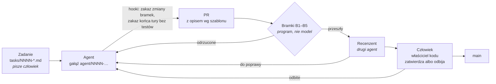

# Agentic SDLC — demo: zadanie → PR agenta → bramki → przegląd → człowiek

Małe repozytorium w C#/.NET pokazujące **kontrolowane wytwarzanie oprogramowania przez agentów AI**:
agent dostaje spisane zadanie, oddaje PR (*pull request* — prośbę o włączenie zmiany), a jego praca
przechodzi przez sprawdzenia, których nie może ominąć ani zmienić. Człowiek zatwierdza na końcu.

Autor: Łukasz Sobierajski. To wycinek metody, którą od marca 2026 prowadzę własną, prywatną platformę
(C#/.NET, ponad 2000 commitów, agenci Claude Code) — przeniesiony na proces oparty na PR-ach,
czyli taki, jaki pasuje zespołom.

**Zacznij od [PR nr 1](../../pull/1)** — to jedno zadanie przeprowadzone od początku do końca,
razem z momentem, w którym bramka cofnęła agenta.

## Przebieg



## Bramki — to, co sprawdza program

| Bramka | Co sprawdza | Gdzie |
|---|---|---|
| **B1** | Kompilacja; ostrzeżenie jest błędem | `dotnet build -warnaserror` |
| **B2** | Testy | `dotnet test` |
| **B3** | Każde kryterium akceptacji zadania ma test, który je wskazuje (`NNNN-Kn`) | `tools/Gates tasks` |
| **B4** | Agent nie zmienił standardów, bramek, potoku ani treści zadania | `tools/Gates paths` |
| **B5** | Opis PR mówi: co zmieniono, JAK sprawdzono, czego autor nie jest pewien | `tools/Gates pr` |

Wszystkie bramki to zwykłe polecenia. Ten sam zestaw woła [GitHub Actions](.github/workflows/ci.yml)
i [Jenkinsfile](Jenkinsfile); zmienia się tylko to, kto je uruchamia.

Dwie z nich działają też **wcześniej**, jako hooki agenta ([.claude/settings.json](.claude/settings.json)) —
hook to własny skrypt, który narzędzie agenta uruchamia samo w określonym momencie:

- **przed zapisem pliku** — odmowa, jeśli plik jest na liście chronionej (to samo co B4);
- **przed końcem tury** — odmowa, jeśli kod się nie buduje, testy nie przechodzą albo kryterium nie ma testu.

Hook jest wygodą (agent dowiaduje się od razu), bramka w CI jest gwarancją (hook da się obejść, CI nie).

## Standardy — to, co czyta agent

[AGENTS.md](AGENTS.md): pięć reguł wymuszanych programem i siedem ocenianych przez recenzenta.
Każda ma podany **powód** — błąd, który naprawdę się zdarzył. Plik kończy się zasadą, jak wolno go
zmieniać: po wpadce nie dokłada się nowej reguły obok, tylko naprawia tę, która miała ją złapać.

## Recenzent — drugi agent

Czyta PR według [docs/reviewer-prompt.md](docs/reviewer-prompt.md). Nie powtarza bramek; szuka tego,
czego program nie oceni: czy test naprawdę sprawdza kryterium, czy tylko nosi jego etykietę; czy agent
nie zrobił czegoś „przy okazji”. Nie poprawia kodu i nie zatwierdza. „Nie wiem — decyduje człowiek”
jest poprawnym werdyktem.

## Gdzie stoi człowiek

1. **Pisze zadanie** — cel, kryteria, „poza zakresem”. Agent nie może zmienić tego pliku.
2. **Jest właścicielem standardów i bramek** ([CODEOWNERS](.github/CODEOWNERS)).
3. **Zatwierdza PR** — po bramkach i po recenzencie, zaczynając od sekcji „Czego nie jestem pewien”.

## Uruchomienie u siebie

```bash
dotnet build -warnaserror
dotnet test --no-build
dotnet run --project tools/Gates --no-build -- tasks agent/0001-walidacja-nrb
```

## Co tu jest uczciwie nie do końca

- **Automatyczny przegląd w CI jest wyłączony** ([przeglad-agenta.yml](.github/workflows/przeglad-agenta.yml)) —
  wymaga klucza do modelu, którego do publicznego repozytorium nie podpinam. Przegląd PR nr 1 wykonał
  drugi agent uruchomiony lokalnie, z tą samą instrukcją; jego komentarz jest w PR.
- **Jenkinsfile nie był uruchamiany** — nie mam pod ręką Jenkinsa. Pokazuje odwzorowanie etapów;
  krok pobierający opis PR z Bitbucketa jest tylko nazwany, skryptu nie ma w repozytorium.
- **Uruchomienie agenta zadaniem z systemu zgłoszeń** (etykieta w Jirze → start agenta) nie jest tu
  zbudowane; agenta uruchomił człowiek, wskazując plik zadania.
- **Brak skanu bezpieczeństwa i zależności** — w banku byłaby to kolejna bramka, przed recenzentem.
- Skala: jeden moduł, jedno zadanie. To pokaz mechanizmu, nie pomiar skuteczności.
